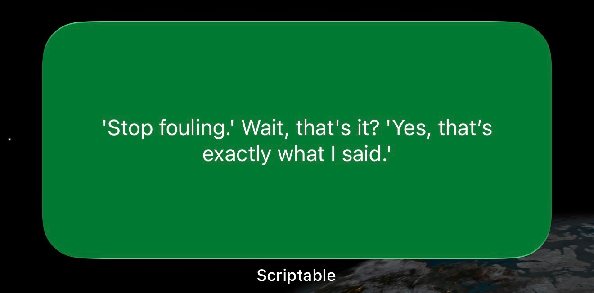

# Daily Joe Mazzulla Quote

An iOS **[Scriptable](https://scriptable.app/)** widget with a daily Joe Mazzulla quote on a Celtics green background. It downloads the quote collection automatically, so you only need to install the script once.

## Setup (iPhone / iPad)

1. Install **Scriptable** from the App Store.
2. Create a new script, or open your existing Mazzulla script.
3. Copy/paste the complete contents of [scriptable.js](scriptable.js), replacing the old script if upgrading.
4. Rename it (for example, `Mazzulla Quotes`) and run it once while online to see a medium preview. Close the preview to see the script version, feed size, and cache status.
5. Add a **medium** (wide rectangular) **Scriptable** widget to your Home Screen, then **Edit Widget** and choose that script. Your existing widget can keep using the same script.

Future quote additions need no copy/paste. Changes to the script itself still require replacing the installed script.

## Daily behavior

- The widget reads [quotes.json](quotes.json) from this repository's `main` branch. It validates the whole feed and saves a local last-good copy; offline requests, invalid feeds, or server errors fall back to that copy. Four original quotes are bundled for a first run without internet.
- The selected quote stays fixed for the local calendar date, even if the collection changes during the day. At the next daily selection, an unseen sourced quote takes priority. Multiple additions are shown in collection order, one per day; after those, the widget cycles through the full collection. These are quotes **new to the collection**, which may include older remarks reported again.
- Calendar dates drive rotation, so daylight-saving changes do not skip or repeat a rotation day. The widget requests a refresh after the next local midnight, but [iOS controls the actual refresh time](https://docs.scriptable.app/listwidget/#refreshafterdate).
- New reviewed entries show one compact paragraph: a brief context lead-in, a space, then the unchanged direct quote in quotation marks or a labeled anecdote. Tap a sourced entry to open its article. The original 39 entries retain their exact text, with no added quotation marks, context, or invented source links.
- The medium layout uses 12 pt padding and 16 pt text, with [native scaling permitted down to 12 pt and no fixed line limit](https://docs.scriptable.app/widgettext/). Long entries can still overflow; actual device fit remains unverified. Run the script in the app to preview today's entry at medium size. The script does not trim or summarize text to fit.

The request timeout is eight seconds. Cached data lives locally in Scriptable's library as `daily-mazzulla-quotes-v1.json`; clearing the app's data resets the displayed/seen history. If device storage cannot read or save that cache, the widget uses the calendar date to rotate instead of repeatedly choosing the first unseen quote. An available saved quote for today stays fixed even if saving fails. Without that snapshot, the fallback can change during the day if the feed changes or storage recovers. Unreadable history is left untouched.

## If the same quote keeps appearing

Replace the installed Scriptable script with the current [scriptable.js](scriptable.js), then run it inside Scriptable and close the medium preview. The **Mazzulla widget status** screen shows the script version, local date, selected quote ID, feed source and entry count, previous saved date, and whether reading/saving the cache worked. Version `2026-10-21.1` adds the storage-failure fallback and this status screen; updating the quote feed alone cannot update the installed script.

If the preview changes but the Home Screen does not, edit the Home Screen widget and confirm it selects this script. iOS controls widget refresh timing, so a correct preview does not prove that the Home Screen has refreshed. If both keep repeating, report the quote and the status screen's local date, feed, and cache lines in the original Mazzulla conversation. The storage-failure case is covered by automated tests; the cause of a particular device's stale widget needs its status information.

## Weekly editorial review

A local cron job runs an ephemeral Codex CLI research session each week. It reads recent reporting, interviews, and accessible video/transcripts, compares them with the approved collection and the complete local review history, and proposes **up to five strong candidates**. Each run overlaps at least the last 14 days and extends earlier to cover gaps. Zero candidates is a normal result. Historical research batches enter the same review queue without advancing the recent-news coverage window.

The assistant judges attribution, context, authenticity, and whether the material fits the collection. There is no keyword filter or automatic publication. Direct quotes keep verified source wording; reported anecdotes are identified as anecdotes and retain the reporter's uncertainty. When needed, a brief visible context lead-in supplies the scene, question, or behavior required to understand the text on its own. A candidate whose text already stands alone uses an empty context string. Its source, publication date and remark/event date when known, editorial explanation, and evidence notes distinguishing article verification from video verification remain separate review metadata. The researcher also checks the live published feed when available and records source-access limitations.

New candidates use the shortest complete, accurate version that works on the medium widget. There is no word-count target; a short quote can stand alone. Context is included only when needed to understand the remark or preserve its essential setup, and fuller background belongs in evidence notes. Entries are never padded to a standard length, and direct quotation wording must stay intact.

The private queue lives on the scheduling machine:

- `review-queue/queue.json` is the source of truth for candidates, decisions, and research history.
- `review-queue/queue.md` is the readable review copy, with stable candidate IDs and candidate numbers that retain the original import order across status groups. Each widget preview shows the actual visible text as one paragraph: context lead-in, then direct quote or labeled anecdote. It previews wording, not the device's wrapping or fit. Source, verification, and editorial notes follow outside the preview. It can be regenerated; edits to this Markdown do not change decisions.
- `review-queue/logs/` contains local execution logs.

The whole directory is gitignored. Pending, approved, and rejected candidates remain in the history so later research can honor decisions and avoid repeats. Nothing is posted to GitHub by the scheduled job, and no ChatGPT Page or built-in scheduled app chat is created.

After the user explicitly approves particular candidates and their wording/context, the assistant records that decision and appends only the approved entries to `quotes.json`. It validates the feed, reviews the diff, and publishes through the repository's normal GitHub process. The widget consumes additions once they are on `main`. Rejected or pending entries never belong in the feed. Approval in the local queue alone does not perform a GitHub write.

## Running the weekly job

The scheduling machine needs Linux, Bash, Python 3.12+, `flock`, `timeout`, and an installed, authenticated Codex CLI supporting `exec --ephemeral`, live web search, and structured output. The job uses the account and model already configured for that CLI. Account usage limits apply; the machine, network, and authentication must remain available.

Create `review-queue/cron.env` locally with the originating thread ID for the existing Agent Inbox integration:

```sh
MAZZULLA_ORIGIN_THREAD='your-original-thread-id'
```

Run a review manually with:

```sh
bash scripts/weekly_review.sh
```

The installed schedule is Monday at **13:17 UTC** on the UTC host. A matching crontab entry uses an absolute repository path:

```cron
17 13 * * 1 /bin/bash /absolute/path/daily-mazzulla-quote/scripts/weekly_review.sh
```

The runner prevents overlapping reviews, gives research up to 30 minutes, and embeds validated feed/queue snapshots directly into the research prompt. The research session runs from a temporary directory with the read-only sandbox and uses web tools without local shell/file reads. A trusted host process validates its final batch and imports candidates as pending. Importing rechecks the current queue under a lock, deduplicates normalized text against the feed and all candidate statuses, and preserves existing decisions. Editorial review also checks less literal duplicates such as another account of the same incident.

A successful empty review still records coverage, the sources actually reviewed, and passed-over leads. Every batch explicitly reports a complete or failed outcome; a completed result must list at least one reviewed article, recording, or transcript. A normal CLI exit with a failed outcome is rejected, and a failed or invalid research result does not import candidates or advance successful history. Queue writes replace a complete temporary JSON file atomically; Markdown is derived afterward. If Markdown writing fails, the JSON remains authoritative and `render` repairs the view. Repeating an identical batch does not duplicate candidates or research history.

When new candidates arrive, a second, brief ephemeral root session updates the originating Agent Inbox with the new and pending counts and directions to return to the original Mazzulla conversation. The weekly job does not create a saved chat or post the candidate text into an existing chat. Open the original conversation and ask to review quotes; the assistant can read `review-queue/queue.json` and show the drafts there. On the scheduling machine, `review-queue/queue.md` is the readable queue. Failures create a privacy-safe needs-action item. The existing configured completion callback handles notifications; the runner does not send a separate message. Finalizer failures leave the queue intact and are recorded in the local run log. Successful reviews with no additions do not trigger an inbox update.

## Reviewing and publishing

Use the rendered queue to review evidence and refer to candidates by their stable IDs. The assistant can import a separately researched historical batch with the same fields as [the batch schema](scripts/review_batch.schema.json); the weekly five-candidate limit does not constrain a manually reviewed historical batch:

```sh
python3 scripts/review_queue.py import /path/to/researched-batch.json
python3 scripts/review_queue.py render
```

Record a user's explicit approval or rejection with a reason:

```sh
python3 scripts/review_queue.py decide candidate-ID approved --reason "User approved this wording and context."
python3 scripts/review_queue.py decide candidate-ID rejected --reason "User's reason for passing on this candidate."
```

These commands only update the local review queue. For publication, append approved records to `quotes.json`, leaving existing IDs stable. Every new record requires:

| Field | Meaning |
| --- | --- |
| `id` | Stable, unique ID containing letters, digits, `_`, or `-` (up to 100 characters). |
| `text` | Verified quote wording or a clearly identified anecdote (up to 3000 characters). |
| `source_url` | HTTPS link to the supporting article or video. |
| `added_at` | Date added to the feed, in `YYYY-MM-DD` format. |
| `kind` | Optional `quote` or `anecdote`; mark reported anecdotes so the widget labels them. |
| `context` | Optional brief visible lead-in before the text, supplying the scene, question, or behavior needed to understand it on its own (up to 500 characters). Omit this field when the queue's context is empty. |

Source titles, evidence notes, editorial reasoning, and actual remark/publication dates stay in the review queue. The original 39 records are grandfathered without invented source metadata. Intentional reviewed corrections remain possible; the migration regression expectation should be updated when making one.

Before publishing, validate the complete feed, inspect the diff for only the approved additions/corrections, and run the checks below. A passing validator checks structure, IDs, source URLs, and dates; it does not establish authenticity or user approval. Keep the private queue and logs out of commits. If a GitHub write conflicts or fails, read the current feed and reconcile the reviewed IDs before retrying, so an uncertain write does not duplicate or overwrite entries.

## Development and verification

Use Python 3.12+ and Node.js 22+. The validators and tests use their standard libraries; no dependency installation is needed.

```sh
python3 scripts/validate_quotes.py
python3 -m unittest discover -s test -p 'test_*.py'
npm test
```

Tests cover feed schema/source validation, preservation of the original collection, queue decisions and deduplication, concurrent imports, interrupted writes, and cron-runner failure/timeout behavior with a fake Codex process. Widget tests cover compact text rendering, context/anecdote labels, native fitting configuration, in-app medium preview, feed/cache failure, daily stability, unseen-quote priority, and DST/year rollover. Tests do not fetch live reporting, prove editorial quality, exercise a real iPhone, establish text fit on a device, or prove when iOS will refresh. The pull-request workflow runs these checks without invoking live research.

## Customization and contributing

- **Research guidance:** edit [the editorial prompt](scripts/weekly_review_prompt.txt), keeping human approval before publication.
- **Background:** change `widget.backgroundColor = new Color("#007A33")` in `scriptable.js`.
- **Font:** change `quoteText.font = Font.systemFont(16)` in `scriptable.js`.
- **Forks:** change `FEED_URL` in `scriptable.js` to the fork's feed.

Please open a **GitHub Issue** with a quote or anecdote and a source link, or a **Pull Request** with sourced additions for review.

## Example


